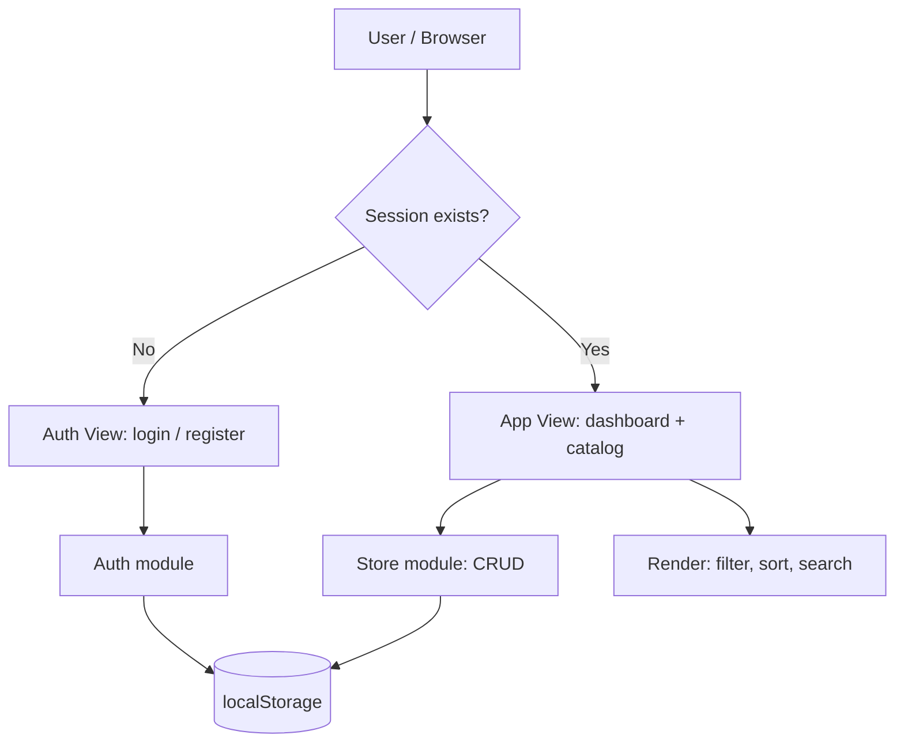
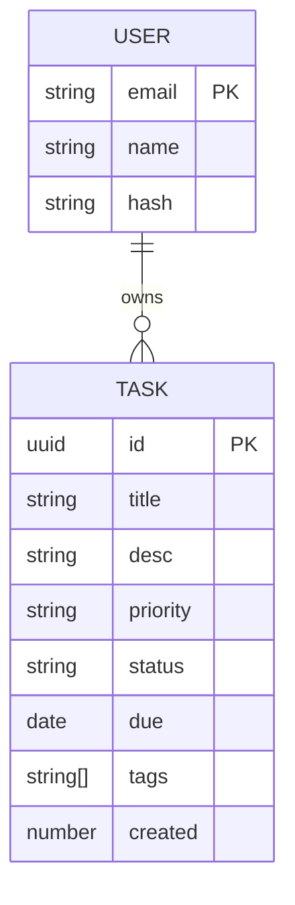
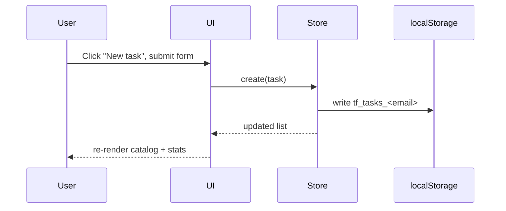

# ✅ TaskFlow – SaaS Task Manager

A production-style, zero-dependency task manager built with vanilla HTML, CSS and JavaScript.
It demonstrates simulated authentication, an interactive catalog, full CRUD, and persistent state.

**🔗 Live demo:** `https://YOUR-APP.vercel.app` *(replace after deploying)*
**📦 Repository:** `https://github.com/YOUR-USERNAME/taskflow`

> Demo login: click **Try demo account**, or use `demo@taskflow.app` / `demo123`.

## Feature highlights

- **Authentication simulation** – register / login / logout, SHA-256 password hashing (Web Crypto), session persisted across reloads, per-user data isolation.
- **Interactive catalog** – live search (title, description, tags), filter by status and priority, sort by date / due / priority / title.
- **Dynamic CRUD** – create, edit, delete tasks in a modal; one-click status advance (To do → In progress → Done).
- **Persistent state** – everything stored in `localStorage`; survives refresh and browser restarts.
- **Extras** – dashboard stats, overdue highlighting, JSON export, dark/light theme, responsive layout, XSS-safe rendering (all user text escaped).

> ⚠️ Auth is a **client-side simulation** for learning purposes. Real products need a server, secure sessions and salted password hashing (bcrypt/argon2).

## Architecture



### Layers (`app.js`)

| Layer | Responsibility |
|-------|----------------|
| `Storage` | Safe JSON wrapper over `localStorage` |
| `Auth` | Register, login, logout, session, password hashing |
| `Store` | Task CRUD scoped to the logged-in user (`tf_tasks_<email>`) |
| UI | `render()`, modal, event handlers, theme, toasts |

### Data model



### Request-free flow: creating a task



## Project structure

```
taskflow/
├── index.html   # markup (auth view, app view, modal)
├── styles.css   # theming via CSS variables
├── app.js       # Storage / Auth / Store / UI
└── README.md
```

## Setup (local)

No build step or dependencies.

```bash
git clone https://github.com/YOUR-USERNAME/taskflow.git
cd taskflow
npx serve .          # or: python3 -m http.server 8000
```
Open `http://localhost:3000` (or `:8000`).

## Deployment

**Vercel:** push to GitHub → vercel.com → *Add New Project* → import repo → framework preset **Other** → Deploy.
**Netlify:** *Add new site → Import from Git* → build command empty, publish directory `.`.
**Cloudflare Pages:** connect repo → no build command, output directory `/`.

## Possible improvements

Real backend (Node + PostgreSQL / Supabase), JWT or OAuth, drag-and-drop board, team collaboration, tests (Playwright).

## License

MIT
